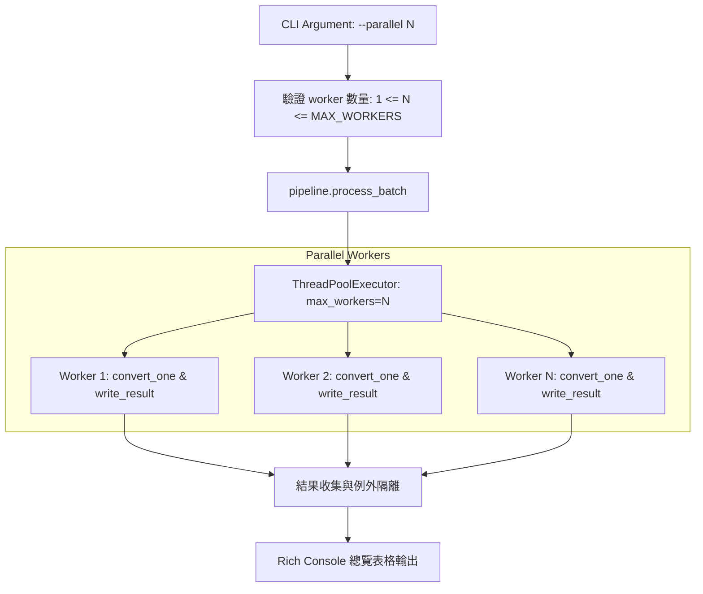

# Design — CHG-002 Batch Parallel Processing

## 1. Architecture

## 2. Technical Details

### 2.1 Worker 上限與安全邊界
- 定義 `DEFAULT_MAX_WORKERS = 4`。
- 若使用者輸入 `parallel <= 0`，拋出參數錯誤。
- 若使用者輸入 `parallel > 8`，終端輸出警示並限縮或要求確認，避免本機 VRAM/RAM 耗盡。

### 2.2 例外處理規範
- 每個工作單元（Task）包裝於獨立 `try-except` 區塊。
- 失敗結果回傳 `BatchItemResult(success=False, error=str(e), path=path)`。
- 所有任務完成（`as_completed`）後統一匯總。

### 2.3 輸出衝突防範
- 偵測輸出目錄中是否已有同名產物，若為同批次內多個副檔名輸入轉換至相同 stem，在命名時注入來源副檔名後綴（例如 `doc_docx.md`）。
