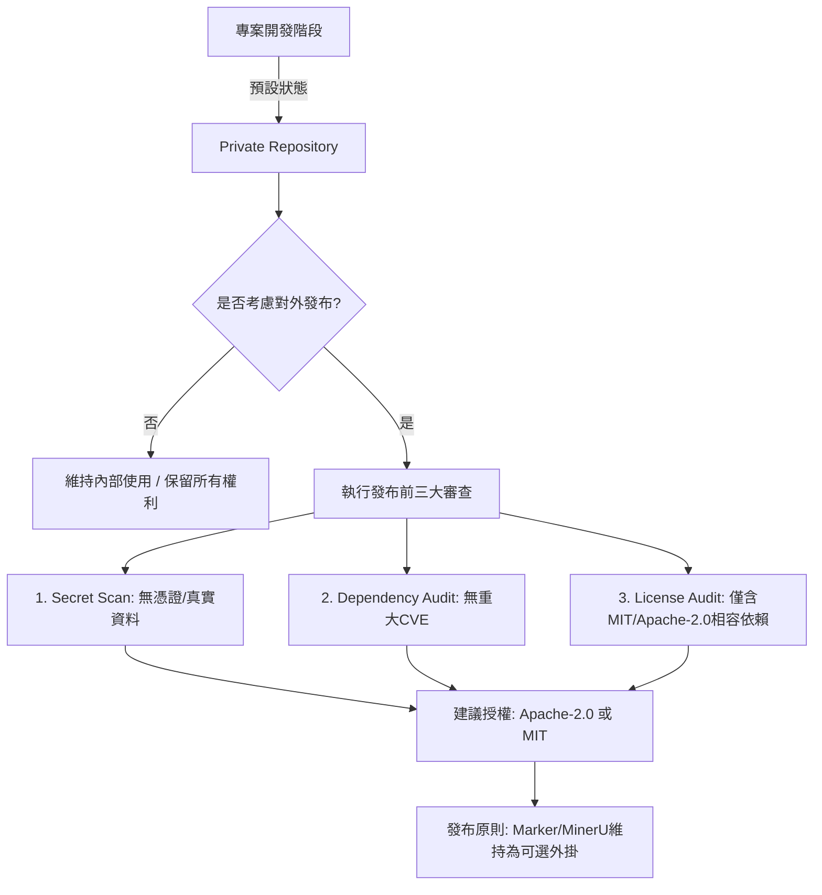

# Document Converter 授權與法規審查報告 (License Audit)

**最後審查日期**: 2026-10-08  
**專案狀態**: Private Repository（內部開發中）  
**審查目標**: 評估核心引擎（Docling）、可選後備引擎（Marker、MinerU）與傳遞依賴（Transitive Dependencies）之程式碼與模型權重授權，制定商業合規防線與專案授權策略。

---

## 1. 審查摘要與核心結論

1. **核心依賴合規性安全**:
   - 預設核心引擎 **Docling** 採用 **MIT License**，其官方 IBM 專案模型權重遵循 **Apache-2.0**，屬於極低風險之寬鬆開源授權（Permissive License），**完全支援內部使用與商業產品整合**。
2. **高風險引擎隔離必要性**:
   - **Marker** 採用 **GPL-3.0**，其核心佈局模型 Surya 與公式識別 Texify 亦具有強 copyleft 或商業限制條款。
   - **MinerU** 涉及 **AGPL-3.0** 模組與部分 **CC-BY-NC-4.0**（非商業用途）之外部模型權重（例如 UniMERNet 或自訂模型）。
   - **結論**: Marker 與 MinerU **不可作為專案強制依賴**，必須隔離為 `optional-dependencies` 或僅透過外部子程序（Subprocess CLI）呼叫，杜絕靜態程式碼感染。
3. **專案自身授權建議**:
   - 目前開發階段**嚴格維持 Private**，不得公開發布。
   - 待專案穩定且若有對外發布需求，建議採用 **Apache-2.0** 或 **MIT**，但必須在發布包（Distribution Wheel / Docker）中**排除任何 Marker / MinerU 預載模型與相依套件**。

---

## 2. 引擎矩陣深度審查

### 2.1 Docling (IBM)
- **軟體套件**: `docling` (v2.x)
- **代碼授權**: MIT
- **模型審查**:
  - `docling-ibm-models` 採用 Apache-2.0。
  - 使用之 OCR 模組：EasyOCR (Apache-2.0)、Tesseract (Apache-2.0)、RapidOCR (Apache-2.0)。
- **授權風險評估**: **低 (Green)**
- **處置規範**: 允許作為預設啟用之解析器。

### 2.2 Marker (Datalab)
- **軟體套件**: `marker-pdf`
- **代碼授權**: GPL-3.0 / Commercial Dual-License
- **模型審查**:
  - `surya` 模型、`texify` 模型受 GPL-3.0 規範，未經授權禁止封裝於閉源商業產品中販售。
- **授權風險評估**: **高 (Red - 強傳染性 / 商業風險)**
- **處置規範**:
  - 移入 `[project.optional-dependencies] marker`。
  - 僅在使用者主動指定 `--engine marker` 且本機環境已自行安裝 CLI 時以 `subprocess` 喚起。
  - 專案內部程式碼不得繼承或 `import` 具感染性之內部函式庫。

### 2.3 MinerU (OpenDataLab)
- **軟體套件**: `magic-pdf` / `mineru` (v0.9 ~ v4.x)
- **代碼授權**: AGPL-3.0 / Apache-2.0
- **模型審查**:
  - 整合之 UniMERNet、PaddleOCR、YOLO、LayoutLMv3 等模型，部分來源宣告 CC-BY-NC 協議。
- **授權風險評估**: **高 (Red - 網路傳染性 / 非商用限制)**
- **處置規範**:
  - 移入 `[project.optional-dependencies] mineru`。
  - 不隨專案打包任何模型權重檔案。
  - 僅提供 adapter 介面，依賴使用者系統 PATH 上的外部執行檔。

---

## 3. 依賴合規審核指令與稽核工具

在開發與 CI 流程中，使用以下標準工具進行持續驗證：

```bash
# 1. 產生完整安裝依賴的授權清單
pip-licenses --format=markdown --with-urls --output-file=docs/DEPENDENCIES_LICENSES.md

# 2. 掃描已知安全漏洞 (CVE / Advisory)
pip-audit --strict --desc

# 3. 檢查是否存在高風險授權 (例如 GPL/AGPL 意外混入核心)
pip-licenses --fail-on="GPL;AGPL;LGPL"
```

---

## 4. 專案授權決策與發布路線圖



### 發布前必備條件：
1. **Repository 權限確認**: 未經審核與核准前，嚴禁將 GitHub Repository 切換至 Public。
2. **測試檔案純淨性**: 所有提交之測試檔案僅能包含合成產生或公眾領域（Public Domain）之無敏感資訊檔案。
3. **無模型重發布**: 任何模型權重一律由終端使用者首次執行時自 Hugging Face / ModelScope 下載，專案代碼庫不包含任何二進位模型資產。
