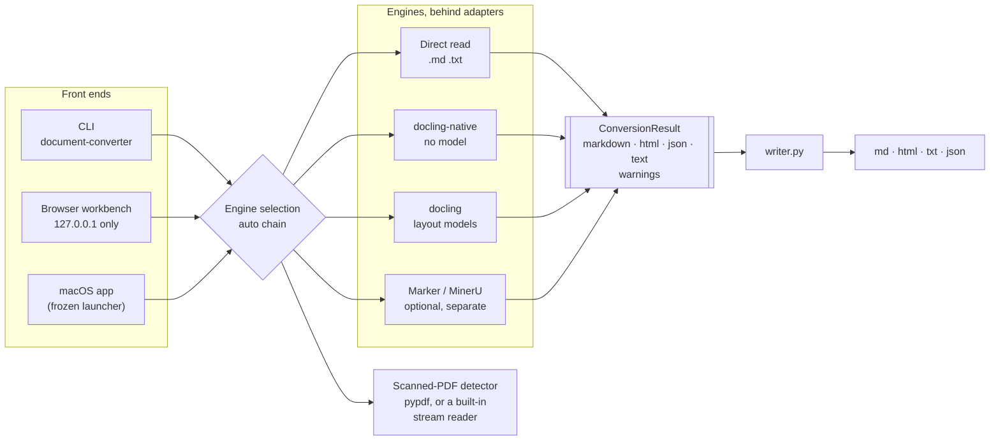

# 2. Architecture

**English** | [繁體中文](02-architecture.zh-TW.md) | [简体中文](02-architecture.zh-CN.md)

## One result shape, many front ends

Every engine returns the same `ConversionResult`. The writer alone turns it into
files. This one rule paid for itself repeatedly:

- **A new output is one place to change.** Plain text was missing from the web
  page; the writer already knew how to render it from Markdown, so every engine
  got it at once — including the `text` app, which runs no engine.
- **A question about the output is asked of the result, not of an engine.**
  "Did this conversion recover any text?" became `ConversionResult.has_recovered_text()`
  ([PR #7](https://github.com/Jake627520/documnet_converter/pull/7)). The earlier
  version lived inside one engine and checked for that engine's own warning, so
  every other engine slipped past it — see [Chapter 3](03-silent-failures.md#9-an-empty-conversion-returned-as-a-success).
- **An engine's quirk is fixed once, at its adapter.** Docling's Markdown
  serializer escapes `&` as `&amp;`. Both Docling adapters serialize through one
  function, so one line undid it for both ([PR #6](https://github.com/Jake627520/documnet_converter/pull/6)).

## Engine selection

`--engine auto` tries engines in order and takes the first that succeeds:

| Input | Order |
| --- | --- |
| `.md` `.txt` | read directly — no engine |
| PDF with a text layer | docling → marker → mineru → **docling-native** |
| Scanned PDF | docling → mineru → marker → **docling-native** |

The model-free reader is always last. It never fails to load, because it needs
nothing downloaded — so on a machine with no PyTorch, every model-based engine
fails, and the conversion still succeeds.

The scanned-PDF detector is what reorders the chain. It once gave different
answers for the same file depending on whether `pypdf` happened to be installed
([Chapter 3, item 5](03-silent-failures.md#5-the-same-pdf-got-a-different-answer-on-a-different-machine)).

## Release profiles are enforced, not configured

A profile is three lists, declared once in `scripts/packaging/profiles.py`:

| List | Enforced where | What happens on a violation |
| --- | --- | --- |
| Accepted inputs | The running app | The upload is refused, naming what the app does accept |
| Forbidden modules | **At build time**, by a check rendered into the PyInstaller spec | The build stops: `Forbidden frozen entry: …` |
| Forbidden distributions | At build time, against the installed environment | The build stops before freezing |

And once more at run time: `--diagnostics` reports the profile, its inputs and
outputs, and `forbidden_loaded` — the forbidden modules actually present in
memory. The release tests require that list to be empty.

So "the `text` app contains no document engine" is not a promise in a README.
A build that would break it does not complete.

## The web workbench treats its own uploads as untrusted

It runs on loopback only, but it still handles a browser upload, and the file
name in an upload is whatever the file was called:

- The file on disk always gets a generated name; the upload's name is never
  used as a path.
- The download is named after the document, but derived from only the last path
  segment, with anything that could end a quoted header or split a header line
  removed, and carried as RFC 6266 UTF-8 so a Chinese file name survives.
- Host and Origin are checked on every request, and at most two run at once.

## Where things live

| Concern | Location |
| --- | --- |
| Engines | `document_converter/engines/` — one adapter each |
| Output serialization | `document_converter/writer.py` — and nowhere else |
| The result shape | `document_converter/models.py` |
| Release profiles | `scripts/packaging/profiles.py` |
| Behaviour specifications | `openspec/specs/` — seven specs, each scenario tied to tests |
