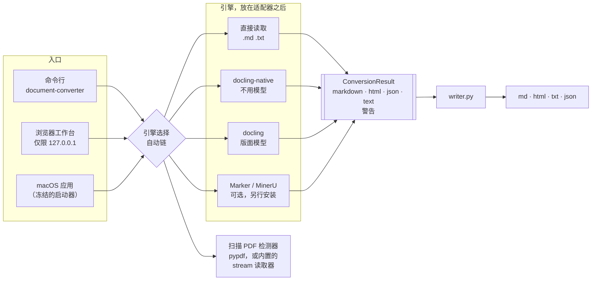

# 2. 架构

[English](02-architecture.md) | [繁體中文](02-architecture.zh-TW.md) | **简体中文**

## 统一的结果结构，多种入口

每个引擎都返回同一种 `ConversionResult`，只有 writer 会把它写成文件。
这一条规则一再证明了它的价值：

- **新增一种输出，只需改一个地方。** 网页原本没有纯文本输出；writer 本来就能从 Markdown 生成纯文本，
  所以所有引擎一次就都有了——包括完全不运行引擎的 `text` 版应用。
- **关于输出的问题，问结果，不问引擎。**“这次转换有没有提取出任何文字？”变成了
  `ConversionResult.has_recovered_text()`（[PR #7](https://github.com/Jake627520/document_converter/pull/7)）。
  之前的版本写在单个引擎里，只检查那个引擎自己的警告，于是其他引擎全都漏了过去——
  见[第 3 章](03-silent-failures.zh-CN.md#9-空的转换结果被当作成功返回)。
- **引擎的怪癖，在它的适配器里修一次就好。** Docling 的 Markdown 序列化会把 `&` 转义为 `&amp;`。
  两个 Docling 适配器都通过同一个函数序列化，所以一行代码就同时修好了两个
  （[PR #6](https://github.com/Jake627520/document_converter/pull/6)）。

## 引擎选择

`--engine auto` 按顺序尝试引擎，采用第一个成功的：

| 输入 | 顺序 |
| --- | --- |
| `.md` `.txt` | 直接读取——不用引擎 |
| 有文字层的 PDF | docling → marker → mineru → **docling-native** |
| 扫描 PDF | docling → mineru → marker → **docling-native** |

免模型读取器永远排在最后。它不会加载失败，因为它什么都不用下载——所以在没有 PyTorch 的机器上，
每个需要模型的引擎都会失败，转换却依然成功。

扫描 PDF 检测器决定了这条链的顺序。它曾经对同一个文件给出不同的答案，取决于 `pypdf` 碰巧有没有安装
（[第 3 章第 5 项](03-silent-failures.zh-CN.md#5-同一个-pdf换台机器答案就不同)）。

## 发行配置是强制执行的，不是配置出来的

一个配置就是三份清单，集中声明在 `scripts/packaging/profiles.py` 中：

| 清单 | 在哪里强制执行 | 违反时会怎样 |
| --- | --- | --- |
| 接受的输入 | 运行中的应用 | 拒绝上传，并列出应用实际接受的格式 |
| 禁用模块 | **构建时**，由写入 PyInstaller spec 的检查执行 | 构建中止：`Forbidden frozen entry: …` |
| 禁用软件包 | 构建时，检查已安装的环境 | 在冻结之前就中止构建 |

运行时还会再检查一次：`--diagnostics` 会报告配置、它的输入与输出，以及 `forbidden_loaded`——
实际出现在内存中的禁用模块。发行测试要求这份清单必须为空。

所以“`text` 版应用不含任何文档引擎”不是 README 里的一句承诺。会违反它的构建根本无法完成。

## 浏览器工作台把自己收到的上传视为不可信

它只在本地回环地址（loopback）上运行，但仍然要处理浏览器上传，而上传中的文件名是那个文件原本叫什么就是什么：

- 存到磁盘上的文件一律使用系统生成的名称；上传的文件名从不当作路径使用。
- 下载文件以文档命名，但只取路径的最后一段，删除任何可能结束带引号标头或拆开标头行的字符，
  并以 RFC 6266 的 UTF-8 格式传输，让中文文件名能够完整保留。
- 每个请求都检查 Host 和 Origin，同时最多处理两个。

## 东西放在哪里

| 关注点 | 位置 |
| --- | --- |
| 引擎 | `document_converter/engines/`——每个引擎一个适配器 |
| 输出序列化 | `document_converter/writer.py`——只在这里 |
| 结果结构 | `document_converter/models.py` |
| 发行配置 | `scripts/packaging/profiles.py` |
| 行为规格 | `openspec/specs/`——七份规格，每个场景都对应到测试 |
