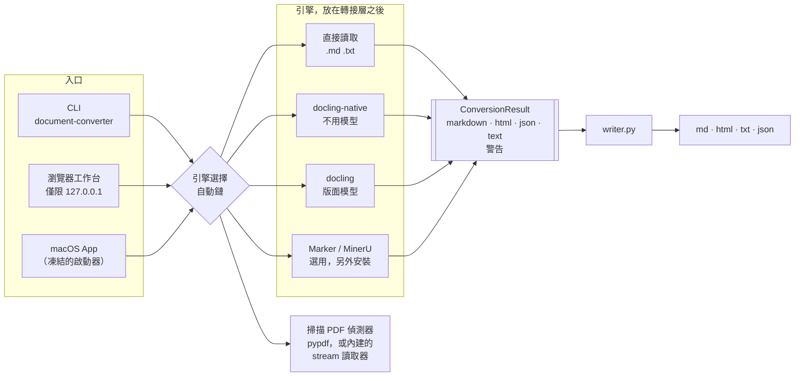

# 2. 架構

[English](02-architecture.md) | **繁體中文** | [简体中文](02-architecture.zh-CN.md)

## 單一結果格式，多種入口

每個引擎都回傳同一種 `ConversionResult`，只有 writer 會把它變成檔案。
這一條規則一再證明它的價值：

- **新增一種輸出，只要改一個地方。** 網頁原本沒有純文字輸出；writer 本來就會從 Markdown 產生純文字，
  所以所有引擎一次就都有了——包括完全不跑引擎的 `text` 版 App。
- **關於輸出的問題，問結果，不問引擎。**「這次轉換有沒有抽出任何文字？」變成了
  `ConversionResult.has_recovered_text()`（[PR #7](https://github.com/Jake627520/document_converter/pull/7)）。
  先前的版本寫在單一引擎裡，只檢查那個引擎自己的警告，於是其他引擎全都漏過去了——
  見[第 3 章](03-silent-failures.zh-TW.md#9-空的轉換結果被當成成功回傳)。
- **引擎的怪癖，在它的轉接層修一次就好。** Docling 的 Markdown 序列化會把 `&` 跳脫成 `&amp;`。
  兩個 Docling 轉接層都透過同一個函式序列化，所以一行就同時修好了兩個
  （[PR #6](https://github.com/Jake627520/document_converter/pull/6)）。

## 引擎選擇

`--engine auto` 依序嘗試引擎，採用第一個成功的：

| 輸入 | 順序 |
| --- | --- |
| `.md` `.txt` | 直接讀取——不用引擎 |
| 有文字層的 PDF | docling → marker → mineru → **docling-native** |
| 掃描 PDF | docling → mineru → marker → **docling-native** |

免模型讀取器永遠排最後。它不會載入失敗，因為它什麼都不用下載——所以在沒有 PyTorch 的機器上，
每個需要模型的引擎都會失敗，轉換卻依然成功。

掃描 PDF 偵測器決定了這條鏈的順序。它曾經對同一個檔案給出不同答案，取決於 `pypdf` 剛好有沒有裝
（[第 3 章第 5 項](03-silent-failures.zh-TW.md#5-同一個-pdf換台機器答案就不同)）。

## 發行設定檔是強制執行的，不是設定出來的

一個設定檔就是三份清單，集中宣告在 `scripts/packaging/profiles.py`：

| 清單 | 在哪裡強制執行 | 違反時會怎樣 |
| --- | --- | --- |
| 接受的輸入 | 執行中的 App | 拒絕上傳，並列出 App 實際接受的格式 |
| 禁用模組 | **建置時**，由寫進 PyInstaller spec 的檢查執行 | 建置中止：`Forbidden frozen entry: …` |
| 禁用套件 | 建置時，檢查已安裝的環境 | 在凍結之前就中止建置 |

執行時還會再檢查一次：`--diagnostics` 會回報設定檔、它的輸入與輸出，以及 `forbidden_loaded`——
實際出現在記憶體中的禁用模組。發行測試要求這份清單必須是空的。

所以「`text` 版 App 不含任何文件引擎」不是 README 裡的一句承諾。會違反它的建置根本無法完成。

## 瀏覽器工作台把自己收到的上傳視為不可信

它只在本機回送介面（loopback）上執行，但它仍然要處理瀏覽器上傳，而上傳裡的檔名是那個檔案原本叫什麼就是什麼：

- 存到磁碟上的檔案一律用系統產生的名稱；上傳的檔名從不當作路徑使用。
- 下載檔以文件命名，但只取路徑的最後一段，移除任何可能結束引號標頭或切開標頭行的字元，
  並以 RFC 6266 的 UTF-8 格式傳送，讓中文檔名能完整保留。
- 每個請求都檢查 Host 與 Origin，同時最多處理兩個。

## 東西放在哪裡

| 關注點 | 位置 |
| --- | --- |
| 引擎 | `document_converter/engines/`——每個引擎一個轉接層 |
| 輸出序列化 | `document_converter/writer.py`——只在這裡 |
| 結果格式 | `document_converter/models.py` |
| 發行設定檔 | `scripts/packaging/profiles.py` |
| 行為規格 | `openspec/specs/`——七份規格，每個情境都對應到測試 |
