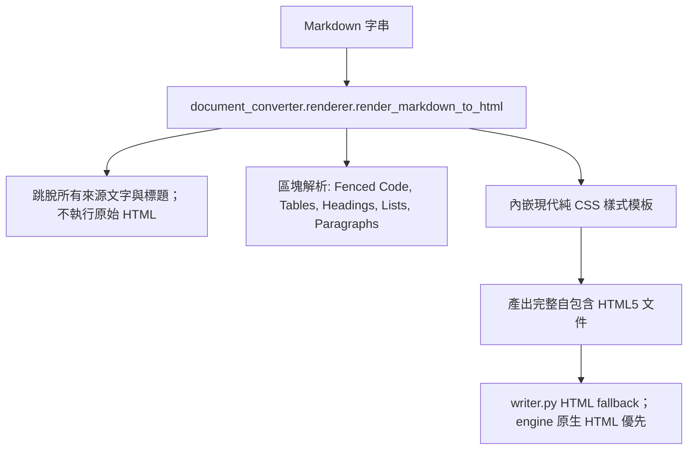

# Design — CHG-001 Standalone Offline HTML Renderer

## 1. Architecture



## 2. Technical Specifications

### 2.1 CSS 樣式系統 (Embedded Modern Theme)
- 使用系統原生字型家族：`-apple-system, BlinkMacSystemFont, "Segoe UI", "Noto Sans", Helvetica, Arial, sans-serif`。
- 支援深淺色自適應 (`prefers-color-scheme: dark`)。
- 美化表格：邊框、交替行底色 (`table`, `th`, `td`)。
- 美化代碼區塊：背景色、等寬字型、圓角邊距 (`pre`, `code`)。

### 2.2 區塊解析規格
1. **Headings**: `#` ~ `######` -> `<h1>` ~ `<h6>`。
2. **Fenced Code**: ` ```lang ... ``` ` -> `<pre><code class="language-lang">...</code></pre>`。
3. **Tables**: `| col1 | col2 |` -> `<table><thead><tr>...</tr></thead><tbody>...</tbody></table>`。
4. **Lists**: `- item` / `* item` -> `<ul><li>...</li></ul>`；`1. item` -> `<ol><li>...</li></ol>`。
5. **Paragraphs**: 連續非空行組成一段；空行分段。
6. **Inline**: `**bold**`, `*italic*`, `` `code` ``。
7. **Escaping**: 標題與內文中的 HTML 特殊字元跳脫；原始 HTML 不執行。程式語言標籤僅接受 `[A-Za-z0-9_+-]+`。LaTeX 不執行，標記作一般文字處理。

### 2.3 零 CDN 驗收限制
產生的 HTML5 檔案內部：
- 絕對不可出現 `http://` 或 `https://` 的外部引用（例如 external stylesheet, external js）。
- 產出的 fallback HTML 可由本機瀏覽器以 `file://` 開啟，CSS 與內容皆內嵌，且不需載入外部資源或網路服務。

## 3. Writer Integration
- `write_result` 有 engine 原生 `result.html` 時原樣寫出。
- 只有 HTML 缺失且 Markdown 欄位不是 `None` 時呼叫內建 `render_markdown_to_html`（包含空字串）。
- HTML fallback 不嘗試載入可選套件；呈現結果不受環境安裝差異影響。
