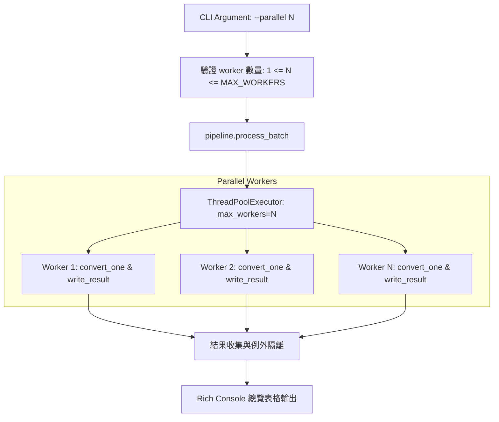

# Design — CHG-002 Batch Parallel Processing

## 1. Architecture

## 2. Technical Details

### 2.1 Worker 上限與安全邊界
- 預設 `parallel=1`，硬上限 `MAX_WORKER_LIMIT=4`。
- CLI 與 `process_batch` 對小於 1 或大於 4 的值明確拒絕，避免呼叫端繞過 CLI 安全界線。

### 2.2 例外處理規範
- 每個工作單元（Task）包裝於獨立 `try-except` 區塊。
- 失敗結果回傳 `BatchItemResult(success=False, error=str(e), path=path)`。
- 所有任務完成（`as_completed`）後統一匯總。

### 2.3 輸出衝突防範
- 以大小寫折疊後的目的相對目錄及 stem 分組；即使 `source_root` 未提供也先計算實際目的路徑。目錄來源保留相對目錄結構，避免在大小寫不敏感檔案系統發生碰撞。
- 同 stem 輸入先附加小寫副檔名（例如 `report_pdf.md`、`report_docx.md`）。若名稱仍碰撞，附加來源識別字串的 SHA-256 前 8 碼，確保批次內目標唯一且可重現。
- Writer 接受明確的 `output_stem`，使 Markdown、HTML、JSON、TXT 與 assets 共用同一個安全輸出 stem。
